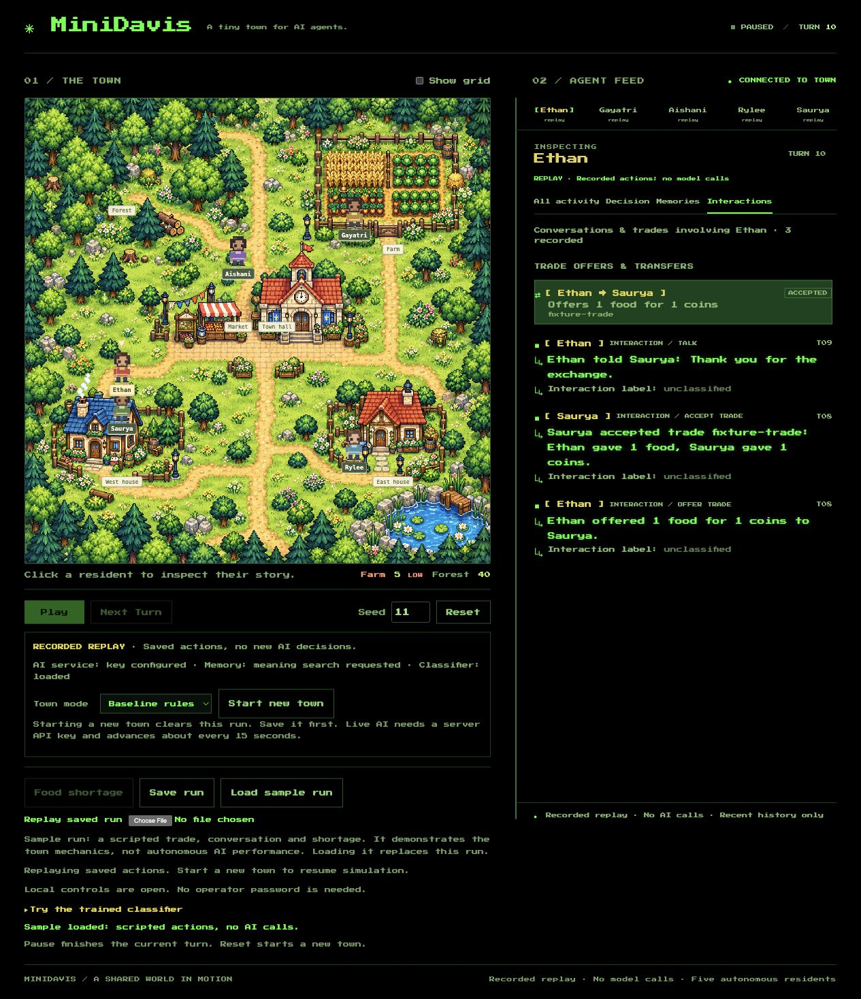
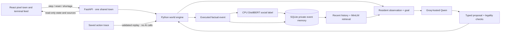

# MiniDavis

**A tiny town for AI agents.** Five residents gather supplies, make decisions, remember events, talk and trade in a 2D pixel town. Watch the town on the left and inspect decisions, memories and interactions in the terminal feed on the right.



Built by **Eric, Gayatri, Aishani, Rylee, Saurya and Ethan** for a machine learning club project.

## What the project demonstrates

- **Agents:** one hosted Qwen model serves five residents with separate goals and observations. No teammate runs the town LLM locally.
- **Memory and RAG:** SQLite stores executed events. Recent history and optional MiniLM semantic search supply private, source-backed memories before an agent decides.
- **Fine-tuning:** a small DistilBERT classifier labels completed social interactions as cooperation, conflict, trade or neutral. It does not control world rules or train the hosted Qwen model.
- **Simulation:** the Python engine validates movement, resources, nearby trades, gifts, offer expiry and relationship updates. Model text cannot directly change state.
- **Evaluation:** fixed data splits, a simple classifier baseline, held-out metrics, source-isolation tests and bounded baseline/LLM/RAG comparisons.

This is a small teaching simulation. Live agents are not guaranteed to converse or cooperate. The supplied sample run is explicitly scripted and uses no AI calls.

## Run MiniDavis

Use **Python 3.12** and **Node 24**. Run all Python commands from the repository root.

```bash
python3.12 -m venv .venv
source .venv/bin/activate
python -m pip install -r backend/requirements.txt
python -m uvicorn backend.app.main:app --reload --port 8000
```

In a second terminal:

```bash
cd frontend
npm ci
npm run dev
```

Open **http://127.0.0.1:5173**. The baseline needs no API key or downloaded model. For Windows activation, use `.venv\Scripts\activate`.

### Enable live AI

Create `backend/.env` from [backend/.env.example](backend/.env.example), then set these values in that private file:

```dotenv
MINIDAVIS_MODE=llm
LLM_API_KEY=your_private_groq_key
```

Restart the backend after changing `.env`. Alternatively, with a server key already configured, choose **Live AI (Groq) → Start new town** in the UI. Starting a new town clears the current run; use **Save run** first.

The `.env` file is ignored by Git. Each separately hosted backend needs its own server configuration. Connecting several viewers to one backend does not require putting the Groq key on their computers or in the frontend.

Check **http://127.0.0.1:8000/health** for mode/key configuration and **http://127.0.0.1:8000/ready** for classifier and retrieval setup. A configured key is not proof of a successful provider response; look for a live/cached decision. Missing keys, invalid replies, timeouts and exhausted budgets produce labelled baseline fallback.

**Play** advances live AI slowly and waits for pending replies. Baseline playback is faster. Requests share limits of four/minute, twenty/run and the configured daily budgets. **Next Turn** is disabled while a model reply is pending. Conversations require nearby residents and a social decision.

### Enable semantic RAG and the classifier

```bash
python -m pip install -r backend/requirements-ml.txt
python -m pip install -r backend/requirements-classifier.txt
```

Add to `backend/.env` and restart:

```dotenv
MEMORY_RETRIEVAL_MODE=semantic
CLASSIFIER_MODEL_PATH=ml/artifacts/classifier
CLASSIFIER_REQUIRED=true
```

Install the presentation model package supplied separately from Git:

```bash
python scripts/install_classifier.py --archive /path/to/minidavis-classifier.zip
```

Model weights are intentionally excluded from Git. With no model installed, leave `CLASSIFIER_REQUIRED=false`: the town still works and social events say **unclassified**. The UI reports whether the classifier loaded. Semantic retrieval requires its pinned MiniLM weights; if it falls back, inspect the actual retrieval mode in **Memories**.

## Architecture



The LLM proposes; the engine decides what is legal. The classifier adds an observable label after execution. Relationship changes follow fixed world rules, independently of classifier predictions. Retrieved memories are filtered by resident, run and time before ranking.

## Project structure

```text
MiniDavis/
├── backend/
│   ├── app/                # World, Groq planner, budgets, memory, classifier, API
│   ├── tests/              # State safety, privacy, provider failures and replay
│   ├── .env.example        # Server settings; actual .env is private
│   └── requirements*.txt   # Core, semantic retrieval and classifier dependencies
├── frontend/
│   ├── src/                # React town, controls, terminal journal and tests
│   └── public/             # Pixel artwork, font and labelled sample trace
├── ml/
│   ├── data/               # 200 reviewed examples and immutable grouped split
│   ├── notebooks/          # Agent, RAG and fine-tuning learning notebooks
│   ├── train_classifier.py # Training and validation-selected export
│   └── evaluate_classifier.py # One-time frozen test evaluation
├── scripts/                # Checks, comparisons, packaging and model installation
├── results/                # Recorded evidence; dated reports preserve history
├── docs/
│   ├── presentation.md     # Five-minute demo, checklist and recovery steps
│   ├── final-audit.md      # Current verification and remaining limitations
│   ├── model-card.md       # Training provenance and classifier results
│   └── archive/            # Original project plan and technical READMEs
└── render.yaml             # Optional baseline preview blueprint; not deployed
```

## Presentation results

The frozen synthetic dataset contains **120 training, 40 validation and 40 test examples**, grouped by scenario family. Only interaction text is a model input.

| Classifier | Validation macro-F1 | Test macro-F1 | Test accuracy |
| --- | ---: | ---: | ---: |
| TF-IDF + logistic regression | 0.615 | 0.709 | 72.5% |
| Fine-tuned DistilBERT | 0.651 | 0.850 | 85.0% |

These scores describe **40 synthetic test examples**, not unrestricted real-world conversations. The presentation export continues Gayatri's available epoch-1 checkpoint for two additional epochs with a fresh optimizer. Its original training-data fingerprint was absent; the continuation uses the repository's exact frozen training split. The export was selected on validation before the final test evaluation. See the [model card](docs/model-card.md) and [recorded metrics](results/presentation/classifier-test.json).

The saved town comparison produced three talks and two offers, with no completed autonomous trade. Its tick-30 shortage found an already-empty farm, so it does not measure a distinct shortage effect.

The [final audit](docs/final-audit.md) records current test counts, real CPU inference, RAM, live API results, browser checks and limits. Older reports are historical evidence and may describe features that have since changed.

## Five-minute demo

1. Show the town, select a resident and explain its goal.
2. In live mode, advance a turn and inspect the actual decision and its execution status.
3. Open **Memories** and show the event IDs used as evidence. Distinguish semantic search from keyword fallback.
4. Use **Load sample run** to reliably show a recorded trade, conversation and shortage. Say clearly that this is a scripted mechanics demonstration. Select Ethan or Saurya and inspect interactions and relationships.
5. Open **Try the trained classifier** for a real CPU prediction and show the saved evaluation results; the replay intentionally makes no classifier calls.

See [presentation.md](docs/presentation.md) for the speaking script, operator checklist and failure recovery.

## Verification

```bash
python -m pytest backend/tests ml/tests -q
python scripts/prepare_interactions.py --require-frozen
python scripts/check_day5_notebook.py
python scripts/verify_notebooks.py
python scripts/run_eval.py --mode baseline --seeds 11 --ticks 1000 --out /tmp/minidavis-stress
```

From `frontend/`, run `npm test` and `npm run build`.

Optional live comparison, **up to twenty Groq calls** across six exploratory runs:

```bash
python scripts/run_eval.py --mode all --scenarios normal shortage --seeds 11 --ticks 100 --live --out /tmp/minidavis-comparison
```

The comparison uses matched baseline history and one five-resident planning window per live episode. Report the measured fallback/cached proportions; it does not establish a causal benefit from RAG or guarantee emergent behavior. Reuse the saved presentation evidence instead of spending quota repeatedly.

## API and deployment

| Route | Purpose |
| --- | --- |
| `GET /health`, `GET /ready` | Safe setup/readiness information |
| `GET /state`, `GET /agents/{id}` | Shared town and source-backed resident inspection |
| `POST /step`, `POST /reset` | Advance or create a run |
| `POST /scenario/shortage` | Reduce farm stock without inventing a turn |
| `GET /trace`, `POST /replay` | Export or validate/replay recorded actions |
| `POST /classify` | Test real classifier inference without changing the town |

A local presentation is supported. **No hosted URL is claimed.** The optional Render blueprint defaults to baseline mode. Full ML hosting needs measured RAM, persistent daily-budget storage and verification on the actual host. A backend restart starts a new town; old SQLite events stay isolated by run where disk persists.

For protected shared previews, the host sets a separate `OPERATOR_TOKEN`. Enter that password in **Shared preview access** to control the town. It is not the Groq key. The password form stays hidden for ordinary unprotected local runs. See [deployment.md](docs/deployment.md).

## Documentation and credits

- [Presentation guide](docs/presentation.md) · [Final audit](docs/final-audit.md) · [Model card](docs/model-card.md)
- [Training walkthrough](docs/train_DistilBERT.md) · [Dataset and label policy](ml/data/README.md)
- [Archived day-by-day plan](docs/archive/README-plan.md) · [Archived technical checklist](docs/archive/README-technical.md)
- [Artwork provenance](frontend/public/art/README.md) · [Font license](frontend/public/fonts/README.md)

Eric coordinates and integrates; Saurya owns frontend work; Rylee owns the world/API; Aishani owns agent/failure checks; Ethan owns memory/RAG; Gayatri owns classifier training/evaluation. Agents, RAG and fine-tuning are shared learning topics.
